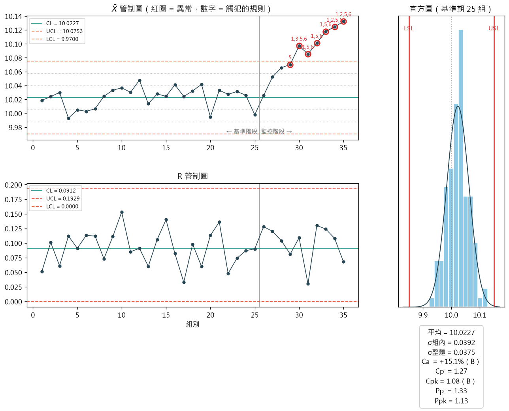
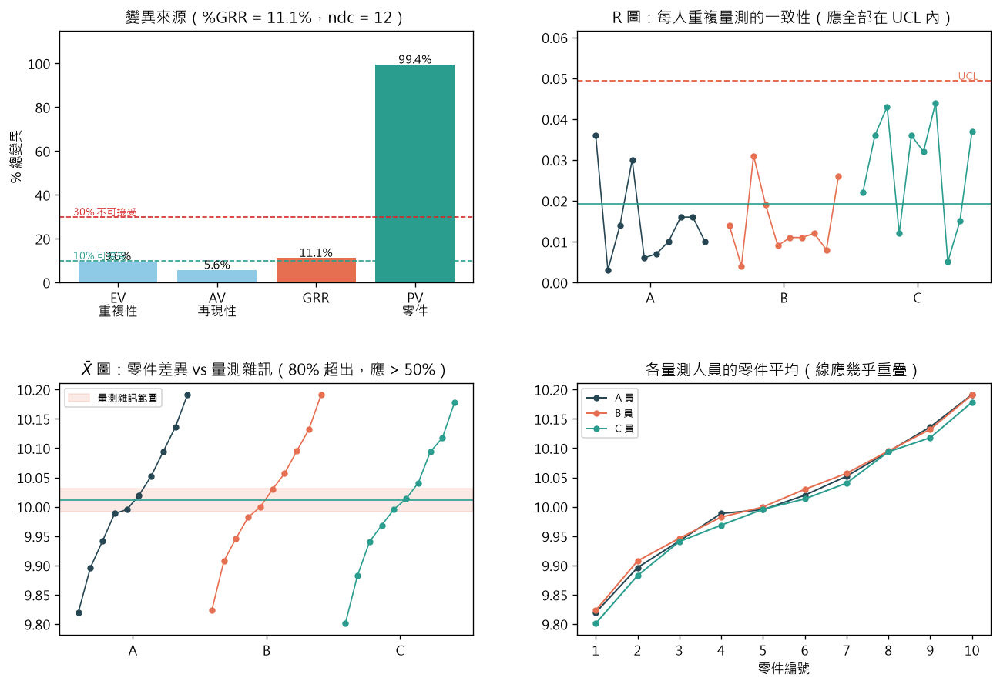
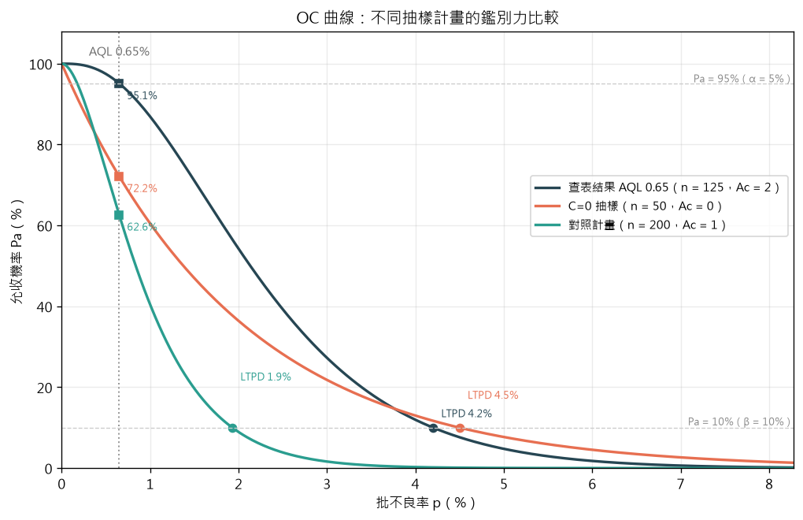

# Quality Engineer Learning — 品質工程學習紀錄

為了準備品質／品管工程師（QE / QC / QA）面試，由淺入深整理品質工程的核心觀念、工具與實務案例。
不只背公式：SPC、GR&R、AQL 等統計方法都以 Python 實作成可重複使用的小工具，並以測試驗證計算結果。




---

## 要解決的問題

品質工程的知識分散在 ISO 標準、AIAG 手冊與各種教材中，名詞多、縮寫多，面試時又常被追問細節：

- **觀念容易混淆：** QC 與 QA、管制界限與規格界限、Cpk 與 Ppk，只背定義很難講清楚差異。
- **公式只會背、不會用：** 管制圖係數、GR&R 的 EV／AV、AQL 查表的箭頭規則，沒實際算過很容易出錯。
- **缺乏實務脈絡：** 面試官想聽的是「遇到客訴怎麼處理」，而不是 8D 每個步驟的名稱。

這個 repo 的做法是：**每個主題都寫成固定架構的筆記，統計方法自己寫程式算一遍，再用模擬案例把手法串起來。**

## 學習路線

| 階段 | 主題 | 筆記 |
| --- | --- | --- |
| 1. 基礎 | 品質基本觀念、QC/QA/IQC/IPQC/OQC、PDCA、4M1E、品質成本 | [01-品質基礎](notes/01-品質基礎.md) |
| 2. 工具 | QC 七大手法、5Why | [02-QC七大手法](notes/02-QC七大手法.md) |
| 3. 統計 | SPC、管制圖、Cp/Cpk | [03-SPC與製程能力](notes/03-SPC與製程能力.md) |
| 3. 統計 | MSA、GR&R | [04-MSA](notes/04-MSA.md) |
| 3. 統計 | 抽樣檢驗、AQL | [05-抽樣檢驗](notes/05-抽樣檢驗.md) |
| 4. 問題解決 | 8D | [06-8D](notes/06-8D.md) |
| 4. 問題解決 | FMEA | [07-FMEA](notes/07-FMEA.md) |
| 5. 系統與改善 | ISO 9001、IATF 16949、APQP/PPAP、CIP、六標準差 | [08-品質系統與持續改善](notes/08-品質系統與持續改善.md) |

八個主題的筆記都已完成，目前進行中的是在每篇最後用自己的話寫「我的回答」。

每篇筆記依固定架構撰寫：

1. **是什麼：** 定義與核心觀念
2. **何時用：** 適用情境
3. **怎麼做：** 步驟與實例
4. **面試怎麼問：** 常見題目與參考回答
5. **我的回答：** 用自己的話整理的回答

## 實作工具

三支工具都是純 Python（NumPy + Matplotlib），可以用內建範例 `--demo` 執行，也能讀入自己的 CSV。
完整說明與範例解讀見 [`tools/README.md`](tools/README.md)。

| 工具 | 功能 | 對應筆記 |
| --- | --- | --- |
| [`spc.py`](tools/spc.py) | X̄-R 管制圖（基準期建立界限、監控期判異）、Nelson 8 條判異規則、Ca/Cp/Cpk/Pp/Ppk 與等級判定 | 03 |
| [`grr.py`](tools/grr.py) | 依 AIAG MSA 手冊的平均值與全距法，計算 EV、AV、%GRR、ndc、%公差，並輸出四張分析圖 | 04 |
| [`aql.py`](tools/aql.py) | 依 ISO 2859-1 查樣本代字與 n／Ac／Re（含 ↑↓ 箭頭規則）、允收判定、OC 曲線與 LTPD | 05 |

### 範例數據的發現

工具的價值在於把「數字」轉成「判斷」。每支工具都附有模擬數據與解讀：

| 工具 | 情境 | 發現 |
| --- | --- | --- |
| `spc.py` | 軸外徑，第 26 組起刀具逐漸磨損 | 第 29 組的點還在管制界限內、量測值也都在規格內，但規則 5 已判定異常，**比出現超規品提早 3 組發出警訊** |
| `grr.py` | 3 人 × 10 零件 × 3 次 | %GRR 11.1%（有條件接受），EV > AV；但 R 圖顯示只有 C 員的 R̄ 將近兩倍，**問題比較可能在量測手法，而不是量具** |
| `aql.py` | 批量 2,000、AQL 0.65 | 查表計畫 n = 125、Ac = 2 在 AQL 處允收機率 95.1%，對應生產者風險 α ≈ 5%；**C=0（n = 50）對供應商較嚴，但 LTPD 4.5% 反而較寬鬆** |

| GR&R 分析 | OC 曲線比較 |
| --- | --- |
|  |  |

### 測試

以 pytest 驗證計算結果，共 32 個測試，涵蓋管制界限與製程能力、Nelson 判異規則、GR&R 各項變異與 ndc、AQL 查表與箭頭規則、
全檢與允收判定等。

```bash
pip install -r requirements.txt
python -m pytest tools -q
```

## 模擬案例

| 案例 | 內容 | 使用手法 |
| --- | --- | --- |
| [8D：外殼卡扣毛邊客訴](cases/8D-外殼卡扣毛邊客訴.md) | 手機外殼卡扣毛邊導致客戶停線，從緊急應變、圍堵、根因分析到水平展開與結案的完整 8D 報告 | 5W2H、IS/IS NOT、魚骨圖、5Why、開關驗證 |

案例延續 [02 QC 七大手法](notes/02-QC七大手法.md) 的射出成型情境，讓不同主題的手法在同一個問題上串起來。情境、公司與數據皆為虛構。

## 面試準備

| 文件 | 用途 |
| --- | --- |
| [面試速查表](interview/面試速查表.md) | 必背數字、公式、差異題、常見陷阱、情境題架構，面試前快速複習 |
| [面試題庫](interview/QA題庫.md) | 依主題整理的面試題，以及各階段練習題 |
| [STAR 回答模板](interview/STAR回答模板.md) | 行為面試題的回答架構與範例 |

複習順序：

1. **讀筆記：** 依 01 → 08 的順序，每篇讀完後把「面試怎麼問」用自己的話寫進「我的回答」。
2. **動手算：** 用筆和計算機做一次 Cpk、GR&R、AQL 查表的手算範例，再用工具驗算。
3. **寫練習題：** 完成[面試題庫](interview/QA題庫.md)最後的「階段練習題」。
4. **準備故事：** 用 [STAR 模板](interview/STAR回答模板.md)準備 3～5 個自己的經驗。
5. **面試前：** 看一遍[面試速查表](interview/面試速查表.md)。

## 使用工具

**需要：** Python 3.10 以上。

```bash
pip install -r requirements.txt

python tools/spc.py --demo                                                     # 內建範例：軸外徑，規格 10.00 ± 0.15
python tools/spc.py --csv tools/data/shaft_od.csv --lsl 9.85 --usl 10.15 --baseline 25

python tools/grr.py --demo                                                     # 內建範例：3 人 × 10 零件 × 3 次
python tools/grr.py --csv tools/data/grr_od.csv --tol 0.60

python tools/aql.py --demo                                                     # 批量 2,000，並與 C=0 等計畫比較
python tools/aql.py --lot 2000 --aql 0.65 1.5 --defects 2 6                   # 查表並判定允收／拒收
```

圖表預設輸出到 `tools/output/`。

## 專案結構

```
notes/                   各主題學習筆記（01～08）
cases/                   模擬案例（8D 報告）
tools/
  spc.py                 X̄-R 管制圖、Nelson 判異、製程能力
  grr.py                 GR&R 平均值與全距法
  aql.py                 AQL 抽樣計畫查詢、OC 曲線
  test_*.py              pytest 測試
  data/                  範例數據（CSV）
  output/                輸出圖表
  README.md              工具說明與範例解讀
interview/               面試速查表、題庫、STAR 回答模板
requirements.txt         NumPy、Matplotlib、pytest
```

## 未來規劃

- 完成每篇筆記的「我的回答」
- 新增 FMEA 模擬案例，與 8D 案例互相對照
- 擴充工具：計數值管制圖（p、np、c、u 圖）

## 參考資料

- ISO 9001:2015 品質管理系統
- IATF 16949:2016 汽車業品質管理系統
- AIAG 核心工具手冊（APQP、PPAP、MSA 第四版、SPC 第二版）
- AIAG-VDA FMEA 手冊（2019）
- ISO 2859-1 計數值抽樣檢驗程序（MIL-STD-105E、CNS 2779）、MIL-STD-1916
- 中華民國品質學會相關教材
