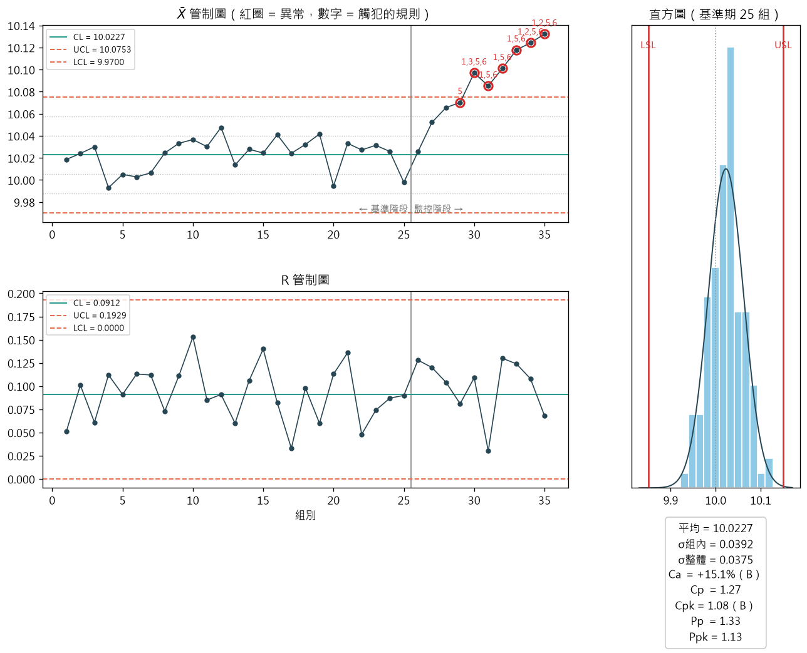

# 工具

## spc.py：X̄-R 管制圖與製程能力分析

輸入子群數據後，程式會：

1. 用**基準期**的數據計算 X̄-R 管制界限（第一階段）
2. 用 8 條 Nelson 規則檢查**所有**數據，包含監控期（第二階段）
3. 計算 Ca、Cp、Cpk（組內 σ）與 Pp、Ppk（整體 σ），並依等級判定
4. 輸出管制圖與直方圖



### 使用方式

```bash
pip install -r requirements.txt

# 內建範例：軸外徑，規格 10.00 ± 0.15
python tools/spc.py --demo

# 使用自己的數據
python tools/spc.py --csv tools/data/shaft_od.csv --lsl 9.85 --usl 10.15 --baseline 25

# 執行測試
python -m pytest tools -q
```

CSV 格式：第一列為欄位名稱，之後每一列是一組，每組 2～10 個量測值。

### 範例解讀

範例數據模擬軸外徑：前 25 組製程穩定，用來建立管制界限；第 26 組起，刀具逐漸磨損，外徑持續變大。

| 組別 | 判異結果 | 解讀 |
|---|---|---|
| 26～28 | 無 | 已經開始上升，但還沒觸發任何規則 |
| 29 | 規則 5 | 3 點中有 2 點在 2σ 以外，**最早發出的警訊** |
| 30 | 規則 1、3、5、6 | 超出管制界限，且連續 6 點上升 → 典型的**刀具磨損趨勢** |
| 34～35 | 規則 1、2、5、6 | 連續 9 點在中心線上方，製程中心已明顯偏移 |

重點：

- 第 29 組的點**還在管制界限內**，但規則 5 已經判定異常，比等到超界（第 30 組）早一組發現問題
- 第 29～31 組的個別量測值**都還在規格內**（USL = 10.15），但製程已經失控；到第 32 組才開始出現超規品。如果只看規格、不看管制圖，要等到不良品出現才會發現，管制圖則**提早 3 組**發出警訊
- 基準期 Cpk = 1.08（B 級），未達 1.33。主要原因是中心偏高（Ca = +15.1%），應先調整中心

### 對應筆記

- [03 SPC 與製程能力](../notes/03-SPC與製程能力.md)
